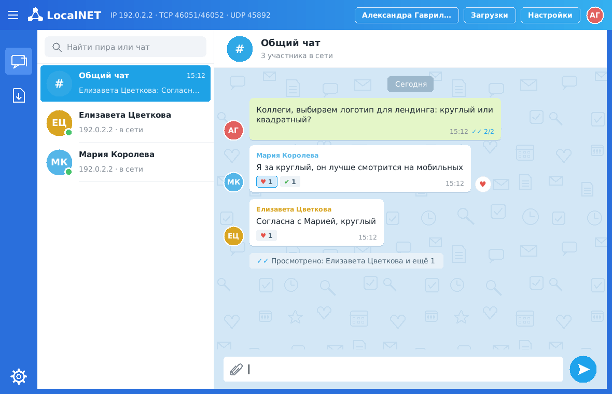
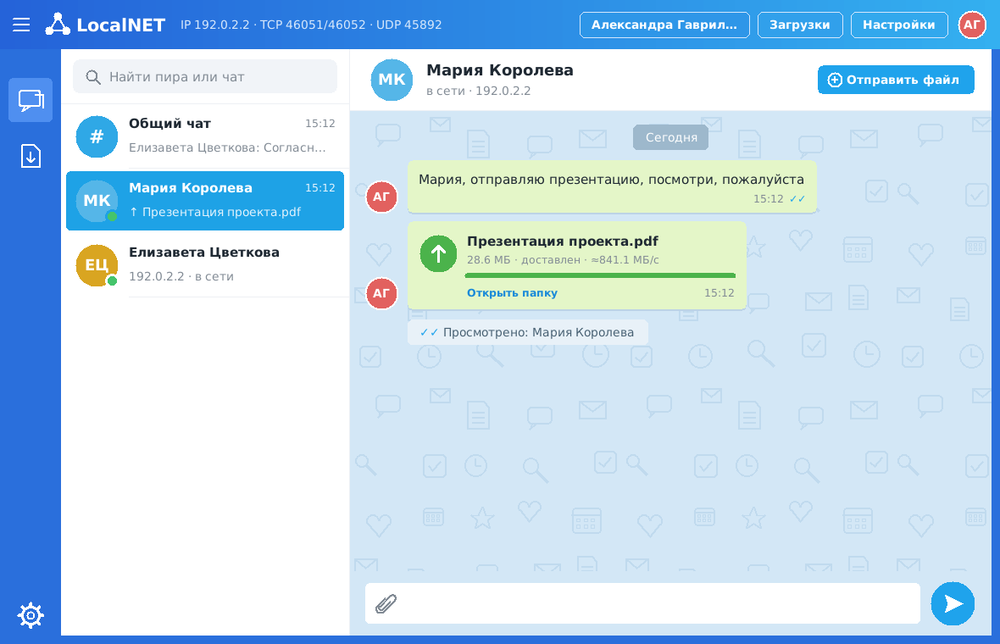

# LocalNET

Портативный LAN-мессенджер и файлообменник для компьютеров одной локальной сети.
Без центрального сервера, без интернета, без прав администратора: просто запустите
`LocalNET.exe` (или `python -m localnet`) на двух машинах одной подсети — они найдут
друг друга за пару секунд.

* **Автообнаружение** — UDP broadcast + multicast, пиры появляются за ≤ 2 с, уходят в offline через 6 с.
* **Чат** — общий (всем online-пирам) и личный; доставка ✓✓, «Просмотрено: …», реакции ♥ ✔ ★ ☺ ☹.
* **История переписки** сохраняется на диске и подгружается после перезапуска; собеседники
  не в сети остаются в списке.
* **Файлы** — прямой TCP, `sendfile()` (zero-copy) на Linux, chunked-режим на Windows;
  SHA-256 проверка целостности, прогресс и скорость, отмена, **докачка** после обрыва.
  RAM не зависит от размера файла (1 ГБ передаётся при ~25 МБ RSS).
* **Портативность** — один исполняемый файл PyInstaller, настройки в JSON рядом с exe
  или в профиле пользователя, порты > 1024, никаких служб и реестра.
* **GUI** на tkinter в стиле современного мессенджера + **CLI** для отладки и машин без графики.
* Windows (основная платформа) и Linux. Python 3.10+.





---

## Быстрый старт

### Linux (в т.ч. Astra Linux) — установка без root

1. Скачайте архив со страницы [Releases](https://github.com/alifirex96/LocalNET/releases):

   | Архив | Когда брать |
   |---|---|
   | `LocalNET-<версия>-linux-x86_64.tar.gz` | Обычный случай. Готовая программа, Python не нужен. Astra Linux 1.8, Debian 12, Ubuntu 22.04+ и новее |
   | `LocalNET-<версия>-python.tar.gz` | **Astra Linux с включённой ЗПС** (замкнутой программной средой), другие архитектуры. Работает на системном `python3` 3.8+ (проверено на 3.11–3.13), pyzmq не нужен |

2. Распакуйте и запустите установщик (в терминале или «Выполнить» в файловом менеджере):

   ```bash
   tar xzf LocalNET-*-linux-x86_64.tar.gz
   cd LocalNET-*-linux-x86_64
   ./install.sh
   ```

   Программа устанавливается в `~/.local/share/localnet`, появляются ярлык в меню
   приложений («Сеть») и на рабочем столе, команда `localnet`. Установщик сам проверит,
   что программа запускается, и подскажет, если нет. Удаление: `./install.sh --uninstall`.

3. Без установки тоже можно: `./LocalNET` в распакованной папке (`./localnet.sh` — для python-варианта).

Если программа не запускается из меню, откроется окно с причиной; журнал запуска —
`~/.config/localnet/logs/launcher.log`. Подробнее — [«Astra Linux»](#astra-linux).

> Не скачивайте отдельный бинарник из артефактов старых сборок CI: ZIP-архив GitHub
> теряет право на исполнение, а сборки до v0.2.0 требовали glibc 2.38+.

### Windows

`LocalNET.exe` — артефакт CI (*Actions → последний запуск → Artifacts → LocalNET-Windows*)
либо соберите сами (см. «Сборка»). При первом запуске Windows может показать окно
брандмауэра — см. [«Брандмауэр»](#брандмауэр).

### Из исходников

```bash
git clone https://github.com/alifirex96/LocalNET.git
cd LocalNET
python3 -m pip install --user -r requirements.txt   # pyzmq — необязательно, см. ниже
python3 -m localnet            # GUI
python3 -m localnet --cli      # консольный режим
```

На Linux для GUI нужен tkinter: `sudo apt install python3-tk` (Debian/Ubuntu/Astra) или
`sudo dnf install python3-tkinter` (Fedora). Без него работает `--cli`.

**pyzmq необязателен.** Без него используется встроенная реализация протокола ZeroMQ
на чистом Python — она полностью совместима: узлы с pyzmq и без него общаются друг с другом.

### Как пользоваться (GUI)

* **Слева** — разделы: «Чаты» и «Файлы» (все передачи), внизу — настройки.
* **Список чатов**: «Общий чат» (сообщение получат все в сети), участники в сети и знакомые
  по истории — аватар, имя, последнее сообщение, время, счётчик непрочитанных; зелёная
  точка — в сети. Поиск сверху фильтрует по имени и IP. «☰» в шапке скрывает список.
* **Переписка**: все сообщения слева, свои — зелёные (как в корпоративных мессенджерах;
  в настройках можно перенести свои вправо). ✓ — отправлено, серые ✓✓ — доставлено,
  синие ✓✓ — прочитано; под последним своим сообщением — «Просмотрено: Мария и ещё 1».
  Сообщение считается прочитанным, когда его чат открыт в активном окне.
* **Реакции**: наведите на сообщение — справа появится ♡, щелчок ставит/снимает ♥.
  Правый клик — меню реакций (♥ нравится, ✔ согласен, ★ важно, ☺ смешно, ☹ грустно)
  и «Копировать текст». Реакции видят все участники чата.
* **Файлы**: кнопка «Отправить файл» в заголовке чата или скрепка у поля ввода. Передача
  показывается карточкой прямо в переписке: прогресс, скорость, «Отменить»; входящий файл —
  «Принять» / «Отклонить» (или включите автоприём в настройках). После проверки хеша —
  «Открыть папку». Неудачную отправку можно повторить одной кнопкой (с докачкой).
* **Настройки** (шестерёнка, кнопка в шапке или свой аватар): имя, папка для файлов
  (по умолчанию `~/Downloads/LocalNET`), автоприём, расположение своих сообщений,
  сохранение истории и «Очистить историю…», сведения об IP, портах и файлах.

### CLI

```
python -m localnet --cli [--nickname Вася] [--auto-accept]

текст                    сообщение в общий чат
/peers                   список пиров
/msg <пир> <текст>       личное сообщение (пир — ник, IP или начало node_id)
/send <пир> <путь>       отправить файл
/transfers               список передач
/cancel <id>             отменить передачу
/accept <id> | /decline <id>
/nick <ник>   /help   /quit
```

Все параметры командной строки: `python -m localnet --help`.

---

## Настройки

Файл настроек ищется в таком порядке:

1. `--config путь.json`;
2. `localnet.json` **рядом с исполняемым файлом** — portable-режим (флешка, сетевая папка);
3. профиль пользователя: `%APPDATA%\LocalNET\config.json` (Windows) или
   `~/.config/localnet/config.json` (Linux) — создаётся автоматически при первом запуске.

```json
{
  "nickname": "ivanov@PC-123",
  "discovery_port": 45892,
  "msg_port": 45893,
  "file_port": 45894,
  "broadcast_addresses": ["255.255.255.255"],
  "multicast_group": "239.255.45.92",
  "static_peers": [],
  "secret": "",
  "download_dir": "",
  "auto_accept": false,
  "announce_interval": 1.0,
  "peer_timeout": 6.0,
  "log_level": "INFO",
  "transport": "auto",
  "save_history": true,
  "own_messages_right": false
}
```

| Поле | Назначение |
|---|---|
| `nickname` | Отображаемое имя (меняется и из GUI). |
| `discovery_port` | UDP-порт обнаружения. **Должен совпадать на всех машинах.** |
| `msg_port` | TCP-порт сообщений (ZeroMQ). Если занят — берётся свободный и анонсируется пирам автоматически. |
| `file_port` | TCP-порт файлов. Аналогично. |
| `broadcast_addresses` | Куда слать анонсы. Если `255.255.255.255` не проходит (несколько сетевых карт, VPN), добавьте адрес подсети, например `"192.168.1.255"`. |
| `multicast_group` | Дополнительный канал анонсов; `""` — отключить. |
| `static_peers` | IP-адреса, которым анонсы шлются напрямую — для сегментов, где broadcast/multicast режутся (разные VLAN). Достаточно указать с одной стороны. |
| `secret` | Общий секрет (HMAC-SHA256). Узлы с разными секретами не видят друг друга и не принимают сообщения/файлы. Пусто — без проверки. |
| `download_dir` | Папка входящих файлов. Пусто — `~/Downloads/LocalNET`. |
| `auto_accept` | Принимать файлы без вопроса. |
| `transport` | Транспорт сообщений: `auto` (pyzmq, если есть, иначе чистый Python), `zmq`, `python`. Совместимы между собой. |
| `save_history` | Сохранять историю переписки на диске (по умолчанию да). |
| `own_messages_right` | Свои сообщения справа (по умолчанию все слева). |

### Как поменять порт

* Навсегда — отредактируйте поля `*_port` в файле настроек.
* Разово — аргументами: `LocalNET.exe --msg-port 50001 --file-port 50002 --discovery-port 50000`.

`discovery_port` должен быть одинаковым у всех. TCP-порты могут различаться —
каждый узел сообщает свои порты в анонсах. Порты ≤ 1024 не используются (они требуют прав root).

История переписки — файл SQLite рядом с настройками: `config.json` → `config.history.db`
(в portable-режиме — рядом с программой). Там же хранится постоянный ID узла, по которому
собеседники узнают вас после перезапуска. Файл не шифруется; при копировании на другой
компьютер или другому пользователю ID узла создаётся заново. Отключить — `save_history: false`,
очистить — кнопкой в настройках.

Логи: `%APPDATA%\LocalNET\logs\localnet.log` или `~/.config/localnet/logs/localnet.log`
(ротация, 3 × 2 МБ). Подробный лог — флаг `--debug`.

---

## Брандмауэр

LocalNET слушает три порта: **UDP 45892** (обнаружение), **TCP 45893** (сообщения),
**TCP 45894** (файлы). Исходящие соединения обычно разрешены, а входящие нужно открыть.

### Windows

При первом запуске Windows Defender Firewall покажет окно «Разрешить доступ».
* Если у пользователя есть права — отметьте **«Частные сети»** / **«Сети домена»** и нажмите «Разрешить».
* **Без прав администратора** разрешить доступ нельзя (кнопка «Отмена» создаёт блокирующее
  правило для входящих). Тогда **исходящие** функции работают (вы видите других, можете
  писать и отправлять им файлы), но вас не видят и не могут прислать файл.
  Попросите администратора добавить правило один раз — через GPO или командой
  (PowerShell от имени администратора):

```powershell
# по программе (надёжнее: работает и при смене портов)
New-NetFirewallRule -DisplayName "LocalNET" -Direction Inbound -Action Allow `
  -Program "C:\Tools\LocalNET\LocalNET.exe" -Profile Domain,Private

# или по портам
New-NetFirewallRule -DisplayName "LocalNET UDP" -Direction Inbound -Action Allow -Protocol UDP -LocalPort 45892 -Profile Domain,Private
New-NetFirewallRule -DisplayName "LocalNET TCP" -Direction Inbound -Action Allow -Protocol TCP -LocalPort 45893-45894 -Profile Domain,Private
```

То же через `netsh` (cmd от имени администратора):

```bat
netsh advfirewall firewall add rule name="LocalNET UDP" dir=in action=allow protocol=UDP localport=45892 profile=domain,private
netsh advfirewall firewall add rule name="LocalNET TCP" dir=in action=allow protocol=TCP localport=45893-45894 profile=domain,private
```

### Linux

```bash
# ufw
sudo ufw allow 45892/udp && sudo ufw allow 45893:45894/tcp
# firewalld
sudo firewall-cmd --permanent --add-port=45892/udp --add-port=45893-45894/tcp && sudo firewall-cmd --reload
```

На большинстве рабочих станций Linux входящий фильтр не включён — ничего делать не нужно.

---

## Astra Linux

Проверено на совместимость с Astra Linux SE 1.8 (glibc 2.36, Python 3.11) по
характеристикам системы; на живой Astra программа не запускалась — сообщите о проблемах.

**Почему могла «ничего не происходить» при открытии.** Возможные причины:

* бинарник собран на новой системе и требует glibc новее, чем в Astra — начиная с v0.2.0
  Linux-сборка делается на Ubuntu 22.04 (glibc 2.35), и CI проверяет это автоматически;
* файл без права на исполнение (так бывает после скачивания) — `install.sh` выставляет права
  и создаёт ярлык;
* `/tmp` смонтирован с `noexec`, а однофайловая сборка PyInstaller распаковывает туда
  библиотеки — Linux-сборка теперь «папкой», без распаковки;
* **включена замкнутая программная среда (ЗПС)**: неподписанные ELF-файлы и библиотеки
  `.so` не запускаются. Установщик это определяет и предупреждает.

**При включённой ЗПС** используйте архив `LocalNET-<версия>-python.tar.gz`. Он запускается
подписанным системным интерпретатором `python3` и не содержит бинарных модулей: протокол
ZeroMQ реализован на чистом Python (`localnet/zmtp.py`). Нужен только пакет `python3-tk`
из репозитория Astra (обычно уже установлен; если нет — администратор:
`sudo apt install python3-tk`). Без него работает консольный режим `localnet --cli`.

Альтернатива для администратора — подписать собранную программу своим ключом
(`bsign`) и добавить ключ в доверенные; это делается по документации Astra Linux.

Если включён запрет интерпретаторов (`astra-interpreters-lock`), python-вариант тоже
не запустится — нужна подписанная сборка или разрешение администратора.

## Сборка исполняемого файла

```bash
python -m pip install -r requirements-dev.txt
pyinstaller --clean --noconfirm build.spec                    # Windows: один файл dist/LocalNET.exe
LOCALNET_ONEDIR=1 pyinstaller --clean --noconfirm build.spec  # Linux: папка dist/LocalNET/
sh packaging/linux/make-release.sh v0.2.0 dist/LocalNET out   # Linux: архивы с install.sh
sh packaging/linux/check-glibc.sh dist/LocalNET 2.35          # проверка совместимости glibc
```

Собирать нужно на той ОС, для которой нужен бинарник (PyInstaller не кросс-компилирует).
Для Linux собирайте на **самой старой** системе, на которой программа должна работать:
бинарник требует glibc не ниже, чем на машине сборки.

Отладочная сборка с консолью (нужна для `--cli` на Windows):

```powershell
$env:LOCALNET_CONSOLE = "1"; pyinstaller --clean --noconfirm build.spec   # → dist/LocalNET-console.exe
```

CI (GitHub Actions) гоняет тесты на Windows и Linux (Python 3.10 и 3.12), отдельно — на
системном Python Ubuntu 22.04 без pyzmq, и собирает Windows-exe и Linux-архивы.

### Выпуск релиза

Пуш тега вида `v*` (или *Actions → Release → Run workflow*) запускает
`.github/workflows/release.yml`: тесты, сборка на Ubuntu 22.04, проверка glibc ≤ 2.35,
упаковка обоих Linux-архивов, установка `install.sh` в чистый профиль и запуск GUI/CLI,
публикация в GitHub Releases вместе с `SHA256SUMS.txt`:

```bash
git tag v0.2.0 && git push origin v0.2.0
```

---

## Тесты

```bash
python -m pip install -r requirements.txt pytest
python -m pytest -v
```

| Файл | Что проверяет |
|---|---|
| `tests/test_discovery.py` | разбор/валидация presence-пакетов, подписи и защита от повтора, таблица пиров (offline, забывание, перезапуск узла) |
| `tests/test_file_transfer.py` | потоковый SHA-256, безопасные имена файлов, кадрирование, chunked- и sendfile-передача с offset, полный протокол на loopback: успех, пустой файл, коллизия имён, отказ, неверный секрет, отмена отправителем и получателем, **докачка**, обнаружение повреждения |
| `tests/test_messaging.py` | личные и общие сообщения, подтверждения, неизвестный пир, неверный секрет — для всех сочетаний транспортов (pyzmq ↔ чистый Python), heartbeat libzmq, переподключение |
| `tests/test_history.py` | история: сохранение и загрузка сообщений, отметок, реакций и передач, непрочитанные, постоянный ID узла, повреждённый файл |
| `tests/test_zmtp.py` | кодек ZMTP 3.0: приветствие, кадры, READY, PING/PONG, несовместимые сокеты, лимиты |
| `tests/test_config.py` | создание/сохранение настроек, исправление некорректных значений, UTF-8 с BOM, повреждённый файл не перезаписывается |

Ручная проверка на одной машине — два экземпляра с разными портами и конфигами:

```bash
python -m localnet --cli --config a.json --nickname alice --msg-port 46001 --file-port 46002
python -m localnet --cli --config b.json --nickname bob   --msg-port 46003 --file-port 46004 --auto-accept
```

---

## Архитектура

```
localnet/
  __main__.py       точка входа, аргументы командной строки
  app.py            LocalNetCore — связывает компоненты, очередь событий для UI, логирование
  config.py         настройки JSON (portable / профиль пользователя)
  discovery.py      UDP broadcast/multicast, разбор пакетов, таблица пиров
  messaging.py      чат по протоколу ZeroMQ ROUTER/DEALER с подтверждениями (pyzmq или чистый Python)
  zmtp.py           реализация ZMTP 3.0 на чистом Python (без бинарных зависимостей)
  history.py        история переписки и постоянный ID узла (SQLite)
  file_transfer.py  TCP-сервер/клиент файлов, sendfile/chunked, SHA-256, докачка
  gui.py            tkinter
  cli.py            консольный интерфейс
  models.py         Peer, ChatMessage, Transfer, события
  utils.py          HMAC, потоковый хеш, безопасные имена, пути
localnet_launcher.py  точка входа PyInstaller
build.spec            спецификация PyInstaller
```

**Потоки.** Каждый компонент работает в своём потоке (`discovery`, `messaging`,
`file-server` и по потоку на каждую передачу). UI общается с ядром через
потокобезопасную очередь событий: GUI забирает её каждые 100 мс в главном потоке
tkinter, поэтому сеть и диск никогда не блокируют интерфейс. При закрытии окна
рассылается `bye`, активные передачи отменяются, сокеты закрываются, потоки дожидаются.

### Обнаружение

Раз в секунду каждый узел шлёт JSON-пакет (< 1 КБ) на UDP 45892: в `255.255.255.255`,
в multicast-группу `239.255.45.92` (TTL = 1, не выходит за пределы LAN) и на `static_peers`.
В пакете: `node_id`, ник, TCP-порты, версия, отметка времени, HMAC-подпись (если задан секрет).
IP пира берётся из адреса отправителя пакета. Новый пир вызывает внеочередной ответный анонс,
поэтому узлы видят друг друга почти мгновенно. Нет пакетов 6 с — пир offline;
при корректном выходе пакет `bye` переводит в offline сразу. Сокет приёма открыт с
`SO_REUSEADDR`, так что на одной машине могут работать несколько экземпляров.

### Сообщения: почему ZeroMQ ROUTER/DEALER, а не PUB/SUB

* У каждого узла один **ROUTER** — «почтовый ящик» на `msg_port`; для отправки пиру
  создаётся **DEALER** (identity = свой `node_id`), подключённый к ROUTER пира.
* **Адресность.** Личное сообщение уходит только адресату. В PUB/SUB фильтрация идёт по
  подписке, и (в зависимости от версии/настроек) личные сообщения физически попадали бы
  ко всем подписчикам.
* **Подтверждения доставки.** ROUTER отвечает отправителю `ack` по тому же соединению —
  отправитель показывает ✓ или «не доставлено» по таймауту. PUB/SUB — односторонний,
  подтверждения потребовали бы второго канала.
* **Нет «slow joiner».** PUB молча теряет сообщения, пока подписчик не подключился;
  DEALER буферизует их до установления соединения.
* **Один порт** на узел вместо PUB + SUB.
* Общий чат — fan-out: одно и то же сообщение отправляется каждому online-пиру. Для
  LAN-масштаба (десятки–сотни узлов) это дёшево и даёт подтверждения от каждого.
* Защита: `MAXMSGSIZE` 256 КБ, проверка `identity == from` (нельзя подделать отправителя),
  дедупликация по `msg_id`, ZMTP-heartbeat для обнаружения «мёртвых» соединений.
* **Два транспорта, один протокол.** Если установлен pyzmq — используется он (libzmq).
  Если нет (или бинарные модули запрещены, как в Astra Linux с ЗПС) — `localnet/zmtp.py`:
  собственная реализация ZMTP 3.0 (механизм NULL, ROUTER/DEALER, PING/PONG) на чистом
  Python. Узлы с разными транспортами совместимы «по проводу» — это проверяется тестами.
  Принудительно выбрать: `"transport": "python"` в настройках или `--transport python`.
* **Прочтение и реакции** — отдельные кадры того же канала: `read` (список id прочитанных
  сообщений — отправителю) и `react` (id сообщения и код реакции — всем участникам чата).
  Подтверждения на них не нужны; узлы старых версий их просто игнорируют.

### Файлы

Файлы **не** идут через ZeroMQ/JSON/HTTP/base64: отдельное TCP-соединение на `file_port`.
Короткое рукопожатие JSON-кадрами (`offer` с именем, размером и SHA-256 → `accept` с
`offset` / `decline`), затем **сырой поток байт**, затем `result` проверки хеша.

* Отправитель: `socket.sendfile()` порциями по 8 МБ — на Linux это системный `sendfile`,
  данные идут из page cache в сокет без копирования в Python. На Windows `os.sendfile`
  отсутствует, поэтому используется chunked-режим с одним переиспользуемым буфером 1 МБ
  (`readinto` + `sendall`, без лишних аллокаций). Буферы сокетов увеличены до 4 МБ.
* Получатель: `recv_into` в буфер 1 МБ → запись в `.part` + инкрементальный SHA-256.
  После совпадения хеша `.part` атомарно переименовывается в итоговое имя
  (`файл (1).ext` при коллизии). Не совпал — файл удаляется, обе стороны видят ошибку.
* **Докачка.** Имя `.part` содержит префикс хеша. Если соединение оборвалось, повторная
  отправка того же файла продолжится с места обрыва (хеш уже полученной части досчитывается).
* **Отмена** — закрытие сокета любой стороной; блокирующие операции прерываются сразу.
* **Таймауты**: подключение 5 с, каждая операция чтения/записи 30 с, ожидание решения
  получателя 120 с.
* Имя файла от отправителя очищается (`../`, запрещённые символы Windows, `CON`, длина).
* SHA-256 файла считается до отправки (это требование метаданных), поэтому перед передачей
  большого файла есть этап «хеширование» (≈ 1–2 с на ГБ с SSD).

---

## Результаты проверки

На одной Linux-машине (loopback, два процесса):

| Сценарий | Результат |
|---|---|
| Обнаружение двух экземпляров | < 1 с |
| Общий и личный чат, подтверждения | ✓ |
| Файл 114 МБ (CLI ↔ CLI, GUI ↔ CLI, собранный бинарник ↔ CLI) | хеш совпал |
| Файл 1 ГБ | хеш совпал, ~540 МБ/с, пиковый RSS ≈ 25 МБ на процесс |

На loopback упор идёт в SHA-256 и диск, а не в сеть. В гигабитной LAN ожидается
~110 МБ/с (предел канала).

## Известные ограничения

* Только IPv4 и одна подсеть (broadcast/multicast не маршрутизируются). Для других
  VLAN — `static_peers`.
* При нескольких сетевых картах на Windows `255.255.255.255` уходит через основной
  интерфейс — добавьте адрес подсети в `broadcast_addresses`.
* Без шифрования трафика: секрет даёт аутентификацию (HMAC), но не конфиденциальность.
  Для LAN этого обычно достаточно; шифрование (CurveZMQ / TLS) — в планах.
* История переписки хранится локально у каждого участника: сообщения, отправленные, пока
  вы были не в сети, не доставляются (нет сервера). Файл истории не шифруется.
* Linux-сборка — только x86_64; для других архитектур (например, Эльбрус, ARM) —
  python-вариант.
* На реальной Astra Linux программа не проверялась (только совместимость по glibc/Python).
* Передача папок целиком пока не поддерживается (можно выбрать несколько файлов).
* Получатель хеширует данные в том же потоке, что и пишет на диск; на 10 GbE это может
  стать узким местом (~1,5–2 ГБ/с SHA-256 на современных CPU).

## Лицензия

MIT — см. [LICENSE](LICENSE).
